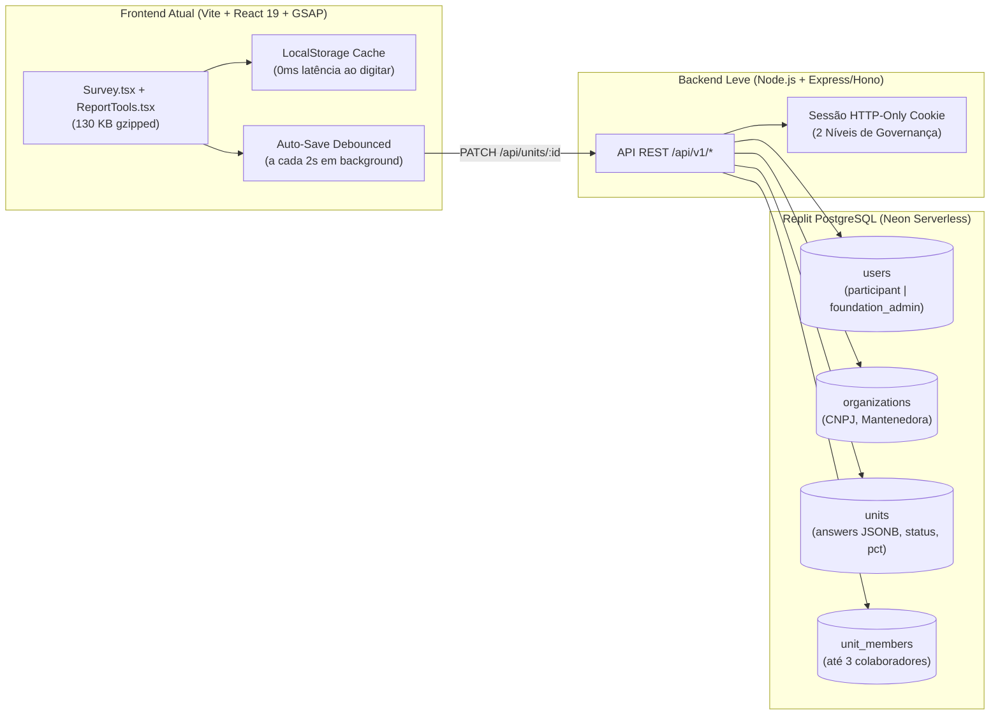

# Plano Técnico de Arquitetura e Prompts Blindados para o Replit — MVP-2 (Fundação Net do Bem)

> [!IMPORTANT]
> **Por que o Replit Agent costuma deixar aplicações lentas e como evitar isso:**
> Quando você pede ao Replit Agent para *"criar login, banco de dados e relatórios"* sem restrições técnicas, ele automaticamente tenta:
> 1. Migrar ou sobrescrever o frontend para templates pesados (Shadcn completo + dezenas de pacotes `@radix-ui`, Recharts/Chart.js, TanStack Query, Framer Motion em cima do GSAP);
> 2. Reescrever componentes existentes (`Survey.tsx` e `survey.css`), quebrando o layout mobile e as animações GSAP que já estão prontos;
> 3. Salvar cada resposta em tabelas normalizadas com `JOIN`s pesados a cada tecla digitada (`onChange`), travando a interface.
>
> **A solução:** Usar uma **Arquitetura Híbrida Blindada** onde o frontend atual (`Vite + React 19 + GSAP + SVG Radar + CSS nativo`, pesando apenas **~130 KB gzipped**) é **congelado visualmente**, e o Replit constrói apenas uma camada de API enxuta (`/api/*`) + Banco PostgreSQL (`JSONB`).

---

## 1. Arquitetura Técnica Recomendada (Alta Performance no Replit)



### Tecnologias Exatas para exigir no Replit:
| Camada | Tecnologia | Motivo de Performance |
| :--- | :--- | :--- |
| **Frontend** | **Manter exatamente o código atual** (`React 19 + Vite + Lucide + GSAP + SVG Nativo`) | Já possui o Gráfico de Radar em SVG puro (`0 KB` extra), Relatório com Ícones e Exportador `.CSV` nativo no navegador. **Proibir instalação de Recharts, Chart.js ou Material UI.** |
| **Backend** | **Express minimalista** (ou **Hono**) em TypeScript servindo `/api/*` e a pasta estática `dist/` | Roda em um único processo Node.js no Replit com consumo mínimo de RAM (< 90 MB). |
| **Banco de Dados** | **PostgreSQL nativo do Replit (Neon)** + **Drizzle ORM** | Drizzle tem zero overhead em runtime. As 151 respostas de cada casa são salvas em uma coluna **`JSONB`** indexada, junto com colunas calculadas (`completion_pct`, `completed_blocks`, `status`), permitindo listar 500+ casas no painel da Fundação em **< 15ms**. |
| **Autenticação & Governança** | **Session Cookie (`express-session` + `connect-pg-simple`) + `bcryptjs`** | Muito mais leve, rápido e estável que OAuth complexo, suportando os **2 níveis de governança (`participant` vs. `foundation_admin`)** direto no middleware. |

---

## 2. Modelagem do Banco de Dados (PostgreSQL + JSONB)

Esta estrutura atende todas as regras de negócio da pesquisa (**1 CNPJ $\rightarrow$ N Casas**, **1 Gestor + até 3 Colaboradores**, e **2 Níveis de Governança**):

```sql
-- 1. USUÁRIOS (2 Níveis de Governança: 'participant' e 'foundation_admin')
CREATE TABLE users (
  id UUID PRIMARY KEY DEFAULT gen_random_uuid(),
  name VARCHAR(140) NOT NULL,
  email VARCHAR(180) UNIQUE NOT NULL,
  password_hash TEXT NOT NULL,
  role VARCHAR(30) NOT NULL DEFAULT 'participant', -- 'participant' | 'foundation_admin'
  job_title VARCHAR(120),
  phone VARCHAR(40),
  created_at TIMESTAMPTZ DEFAULT NOW()
);

-- 2. MANTENEDORAS (1 CNPJ pode ter várias Casas vinculadas)
CREATE TABLE organizations (
  id UUID PRIMARY KEY DEFAULT gen_random_uuid(),
  cnpj VARCHAR(20) UNIQUE NOT NULL,
  legal_name VARCHAR(200) NOT NULL,
  owner_user_id UUID REFERENCES users(id) ON DELETE SET NULL,
  shared_answers JSONB NOT NULL DEFAULT '{}'::jsonb,
  created_at TIMESTAMPTZ DEFAULT NOW()
);

-- 3. CASAS / UNIDADES DE ACOLHIMENTO (Respostas e Progresso Pré-Calculado)
CREATE TABLE units (
  id UUID PRIMARY KEY DEFAULT gen_random_uuid(),
  organization_id UUID NOT NULL REFERENCES organizations(id) ON DELETE CASCADE,
  name VARCHAR(160) NOT NULL,
  city VARCHAR(120) DEFAULT 'São Paulo',
  uf CHAR(2) DEFAULT 'SP',
  status VARCHAR(40) NOT NULL DEFAULT 'Rascunho', -- Rascunho | Enviada | Em análise | Ajustes solicitados | Aprovada
  current_page INTEGER NOT NULL DEFAULT 0,
  completion_pct INTEGER NOT NULL DEFAULT 0,
  completed_blocks INTEGER NOT NULL DEFAULT 0,
  answers JSONB NOT NULL DEFAULT '{}'::jsonb,
  snapshot JSONB,
  foundation_feedback TEXT,
  updated_at TIMESTAMPTZ DEFAULT NOW()
);

-- 4. EQUIPE DA MANTENEDORA (Até 3 colaboradores convidados por CNPJ)
CREATE TABLE organization_members (
  id UUID PRIMARY KEY DEFAULT gen_random_uuid(),
  organization_id UUID NOT NULL REFERENCES organizations(id) ON DELETE CASCADE,
  email VARCHAR(180) NOT NULL,
  permission VARCHAR(20) NOT NULL DEFAULT 'Editor', -- 'Editor' | 'Leitor'
  invited_by UUID REFERENCES users(id),
  created_at TIMESTAMPTZ DEFAULT NOW(),
  UNIQUE(organization_id, email)
);
```

---

## 3. Sequência de Prompts Prontos para Colar no Replit

> [!TIP]
> **Como usar:** No Replit, importe o repositório do GitHub (`MVP-2`) e cole os prompts abaixo **um por vez**, na ordem exata. Eles foram escritos com **travas de proteção** para impedir que o Replit estrague o layout ou instale pacotes pesados.

### Passo 1 — Prompt de Blindagem Inicial (Criar `replit.md` / Instrução de Sistema)
Cole este primeiro prompt no chat do Replit antes de pedir qualquer código:

```text
Você vai adicionar backend, autenticação e banco de dados PostgreSQL a esta aplicação React + Vite já pronta e otimizada (MVP-2 da Fundação Net do Bem).

REGRAS ESTRITAS DE PERFORMANCE E ARQUITETURA (NÃO VIOLE):
1. NÃO instale bibliotecas pesadas de UI ou gráficos (PROIBIDO instalar Recharts, Chart.js, MUI, Chakra, Antd, Framer Motion ou Tailwind). O projeto já possui CSS nativo otimizado (`src/survey.css`), animações GSAP e Gráfico de Radar em SVG nativo (`src/ReportTools.tsx`).
2. NÃO altere o layout, as classes CSS, as 14 etapas do `src/questionnaire.json`, as artes `.webp` em `public/cards/` nem a estrutura visual de `src/Survey.tsx` e `src/ReportTools.tsx`.
3. Use Express + TypeScript + Drizzle ORM (`drizzle-orm` + `pg`) para o backend.
4. Salve as respostas do questionário em colunas `JSONB` no PostgreSQL (nunca crie 150 tabelas ou 150 linhas por auto-save).
5. Mantenha o auto-save instantâneo no `localStorage` no frontend e faça sincronização com o banco via debounce de 2000ms (`PATCH /api/units/:id/answers`) para nunca travar a digitação do usuário no celular.

Confirme que entendeu essas 5 regras e crie apenas a estrutura inicial do banco PostgreSQL com Drizzle (`shared/schema.ts`) contendo as tabelas: `users`, `organizations`, `units` e `organization_members`.
```

---

### Passo 2 — Prompt de Autenticação e 2 Níveis de Governança
Depois que ele criar o `schema.ts`, envie este segundo prompt:

```text
Agora implemente a autenticação leve no backend (`server/auth.ts` e `server/routes.ts`) com `express-session`, `connect-pg-simple` e `bcryptjs`, atendendo aos 2 níveis de governança:

1. NÍVEL 1 — PARTICIPANTE DA PESQUISA (`role = 'participant'`):
   - Pode se cadastrar informando: Nome, E-mail, Senha, Nome da Entidade, CNPJ e Nome da Primeira Casa.
   - Ao fazer login, acessa apenas os dados da sua própria `organization` (suas casas vinculadas ao mesmo CNPJ e até 3 colaboradores em `organization_members`).
   - NÃO tem acesso às rotas `/api/admin/*` nem vê o menu da Fundação.

2. NÍVEL 2 — GESTOR DA FUNDAÇÃO NET DO BEM (`role = 'foundation_admin'`):
   - Acesso restrito aos gestores da Fundação.
   - Pode acessar `GET /api/admin/overview` (lista todas as organizações, usuários cadastrados, casas, `completion_pct`, `completed_blocks`, `status` e respostas completas) e `POST /api/admin/units/:id/decision` (para aprovar, pedir ajustes ou registrar devolutiva).
   - Crie uma seed automática para um usuário gestor inicial da Fundação (lendo `ADMIN_EMAIL` e `ADMIN_PASSWORD` das variáveis de ambiente / Secrets do Replit).

Não altere o design do formulário nem dos cards. Apenas crie as rotas de API e conecte o tela de Login/Acesso (`screen === 'access'`) em `src/main.tsx`.
```

---

### Passo 3 — Prompt de Auto-Save Híbrido (0ms de Latência no Mobile)
Depois que o login estiver rodando, envie este terceiro prompt:

```text
Agora conecte o estado `state` do `src/main.tsx` ao backend seguindo o padrão Offline-First / Debounced Sync:

1. Ao carregar a sessão autenticada (`GET /api/me/state`), hidrate `state` (`org`, `units`, `members`) a partir do PostgreSQL e salve também no `localStorage` (`netdobem-mvp-v2`).
2. Quando o usuário responder qualquer pergunta na função `answer(q, value)`:
   - Atualize o estado React e o `localStorage` imediatamente (0ms de latência).
   - Agende um `debounce` de 2000ms para enviar `PATCH /api/units/:unitId/answers` com `{ org, answers, page, completion_pct, completed_blocks }`.
   - Exiba o indicador `✓ Salvo` já existente no header quando o `PATCH` retornar `200 OK`.
3. Conecte os botões de "Adicionar casa" (`POST /api/units`), "Convidar colaborador" (`POST /api/members`, limitado a 3 por CNPJ) e "Concluir e Enviar Diagnóstico" (`POST /api/units/:unitId/submit`).
```

---

### Passo 4 — Prompt do Painel Restrito da Fundação (`/fundacao`)
Por fim, envie este quarto prompt para conectar a visão da Fundação ao banco real:

```text
Agora conecte a tela restrita `screen === 'admin'` em `src/main.tsx` ao endpoint `GET /api/admin/overview`:

1. Garanta que `screen === 'admin'` só possa ser aberta se `currentUser.role === 'foundation_admin'`. Caso o usuário seja `participant`, o menu da Fundação deve permanecer 100% invisível e qualquer tentativa de acesso deve redirecionar para `portal` ("Minha Entidade").
2. Na tela `admin`, popule a lista de unidades e usuários cadastrados diretamente do PostgreSQL, mantendo:
   - Os cards de KPIs no topo (Total de Casas, Média de % Preenchido, Para Analisar, Aprovadas);
   - A barra de progresso de `% preenchido` e `X/14 etapas` de cada casa;
   - O botão "Ver Relatório" que abre o `DiagnosticRadarSection` (Gráfico de Radar) e o `DetailedIconReport` (Relatório com Ícones) daquela casa;
   - Os botões de exportação `.CSV` individual e geral (`exportUnitReportCsv` e `exportAllUnitsNetworkCsv`).
```


---

## 4. Plano Passo a Passo: Repositório Privado no GitHub, Segurança e Nova URL no Replit

Para manter o código, as credenciais do banco e os dados das instituições **100% seguros** durante e após a migração para o Replit, siga este roteiro passo a passo:

### Etapa A — Tornar o Projeto Privado no GitHub (Segurança do Código)
1. **Opção Recomendada (Repositório Dedicado Privado para a Aplicação):**
   - Caso o repositório atual (`FUNDACAO-NETDOBEM`) também sirva o site institucional na Vercel, o ideal é criar um repositório novo **Privado** no seu GitHub chamado, por exemplo, `netdobem-pesquisa-app` contendo apenas o conteúdo da pasta `MVP-2/`, **ou** tornar o repositório atual privado em:
   - **GitHub $\rightarrow$ Settings $\rightarrow$ General $\rightarrow$ Danger Zone $\rightarrow$ Change repository visibility $\rightarrow$ Change to private**.
2. **Proteção de Credenciais (`.gitignore`):**
   - Nunca salve senhas ou URLs de banco no código. Garanta que o arquivo `.gitignore` na raiz contenha:
     ```gitignore
     node_modules/
     dist/
     .env
     .env.*
     *.local
     ```

### Etapa B — Importar o Repositório Privado no Replit com Segurança
1. Acesse sua conta no **Replit** e clique em **Create Repl $\rightarrow$ Import from GitHub**.
2. Caso o repositório já esteja **Privado**, clique em **Connect GitHub account** e autorize o Replit a enxergar seus repositórios privados.
3. **Importante (Privacidade do Repl):** Na tela de criação do Repl, marque a chave **Private Repl** (disponível no Replit Core/Teams). Assim, nem o código no GitHub nem o container do Replit ficam visíveis publicamente.
4. **Configurar os Segredos (Replit Secrets — Cadeado Lateral):**
   - Abra a aba **Secrets** (ícone de cadeado no painel esquerdo do Replit) e cadastre as variáveis de ambiente fora do código:
     - `SESSION_SECRET`: uma chave longa aleatória (ex.: 64 caracteres) para assinar os cookies de login;
     - `ADMIN_EMAIL`: o e-mail oficial do gestor da Fundação Net do Bem;
     - `ADMIN_PASSWORD`: uma senha forte exclusiva da Fundação;
     - `DATABASE_URL`: (gerada automaticamente quando você adiciona o banco PostgreSQL nativo do Replit na aba **Database**).

### Etapa C — Executar os 4 Prompts Blindados e Testar
1. Cole os **Passos 1, 2, 3 e 4** da Seção 3 deste documento no Replit Agent, um de cada vez.
2. Teste os dois fluxos na janela de preview do Replit:
   - **Fluxo Participante (Senhoras / Coordenadoras):** Capa $\rightarrow$ Tela de Criação de Login (`Criar meu acesso (1ª vez)`) $\rightarrow$ Tutorial em 4 Balões de Popup animando o Card 1 $\rightarrow$ Preenchimento e Relatório com Radar.
   - **Fluxo Gestor da Fundação:** Login com o `ADMIN_EMAIL` $\rightarrow$ Acesso ao painel `#fundacao` $\rightarrow$ Visualização de todas as casas, `% preenchido` e exportação `.CSV`.

### Etapa D — Publicar e Direcionar para a Nova URL Oficial
Você tem **2 formas limpas** de apontar a nova URL oficial para a aplicação publicada no Replit:

#### Opção 1: Subdomínio Dedicado (ex.: `pesquisa.netdobem.org.br` ou `cadastro.netdobem.org.br`) — *Mais Recomendado*
1. No Replit, clique no botão **Deploy** (canto superior direito) e escolha **Autoscale Deployment** (ou **Reserved VM**).
2. Configure:
   - **Build command:** `npm run build`
   - **Run command:** `npm run start`
3. Assim que o Deploy concluir, abra a aba **Domains** dentro de Deployments no Replit e clique em **Link a domain**.
4. Digite a nova URL desejada (ex.: `pesquisa.netdobem.org.br`).
5. O Replit fornecerá **2 registros DNS** (um registro `A` ou `CNAME` e um registro `TXT` de verificação).
6. No painel onde fica o DNS de `netdobem.org.br` (Registro.br, Cloudflare ou Vercel DNS), adicione esses 2 registros. Em poucos minutos o certificado SSL (`https://`) é emitido automaticamente pelo Replit.

#### Opção 2: Manter em `https://www.netdobem.org.br/mvp-2` (ou `/pesquisa`) via Proxy Transparente na Vercel
Se você quiser que o endereço continue dentro do domínio principal `www.netdobem.org.br/pesquisa` enquanto o backend + banco rodam no Replit:
1. Publique o app no Replit Deployment (ele ganhará uma URL interna `https://seu-app.replit.app`).
2. No arquivo `vercel.json` do site principal, adicione um `rewrite` apontando para a URL do Replit:
   ```json
   {
     "rewrites": [
       {
         "source": "/pesquisa/:path*",
         "destination": "https://seu-app.replit.app/:path*"
       }
     ]
   }
   ```
3. Dessa forma, o visitante acessa `https://www.netdobem.org.br/pesquisa`, mas toda a aplicação, login e banco de dados PostgreSQL rodam diretamente no servidor seguro do Replit.
